## 1. Nội dung thực hiện

Thực hiện các ví dụ mẫu về Express Framework bằng Node.js trên máy tính cá nhân.

Các nội dung đã thực hiện:

- Tạo ứng dụng Express đầu tiên.
- Định tuyến với Route.
- Sử dụng Middleware.
- Sử dụng Template Engine Pug.
- Sử dụng Template Engine Handlebars.
- Xử lý lỗi (Error Handling).
- Xây dựng ứng dụng máy tính sử dụng mô hình MVC.

## 2. Cấu trúc thư mục

```text
Baitapvidu/
├── EXPRESS/
│   ├── views/
│   ├── app.js
│   ├── express_route.js
│   ├── express_middleware.js
│   ├── express_pug.js
│   ├── express_handlebars.js
│   ├── express_error.js
│   ├── package.json
│   └── package-lock.json
│
├── my-express-app/
│   ├── controllers/
│   ├── models/
│   ├── public/
│   ├── views/
│   ├── app.js
│   ├── package.json
│   └── package-lock.json
│
├── images/
└── .gitignore
```

## 3. Hình ảnh kết quả thực hiện

### 3.1. Express

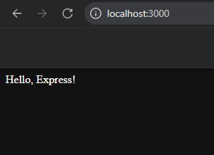

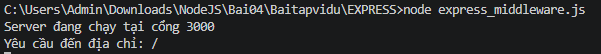

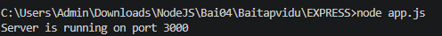

### 3.2. Route

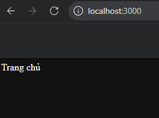

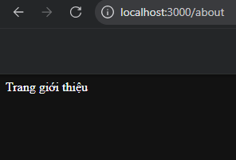

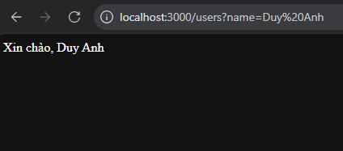

### 3.3. Middleware

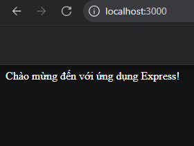

### 3.4. Template Engine Pug

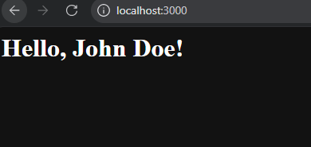

### 3.5. Template Engine Handlebars

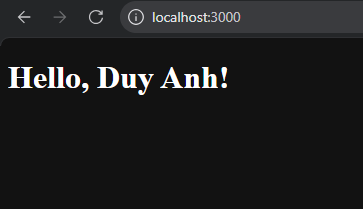

### 3.6. Error Handling

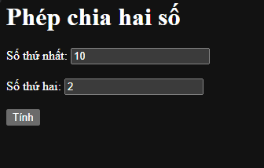

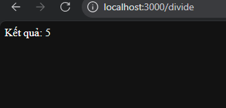

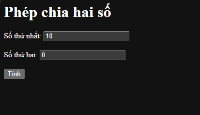

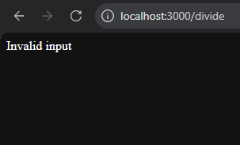

### 3.7. Dự án Express kết hợp MVC

**Phép cộng**

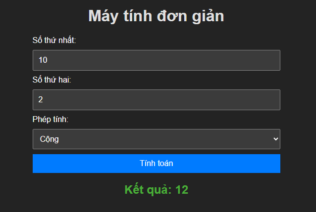

**Phép trừ**

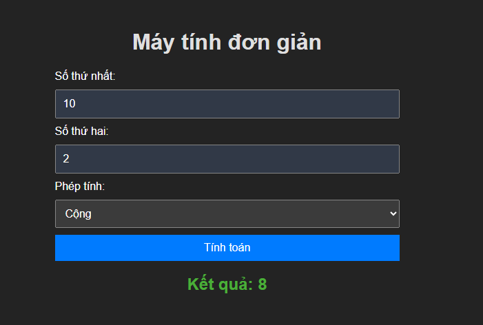

**Phép nhân**

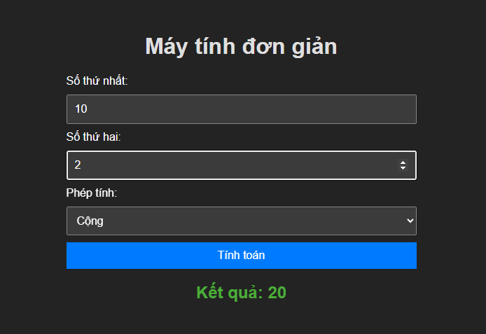

**Phép chia**

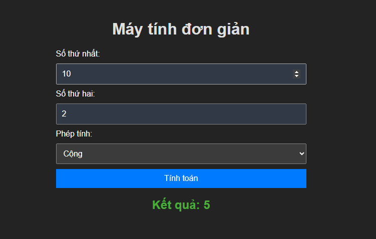

**Kiểm tra xử lý lỗi**

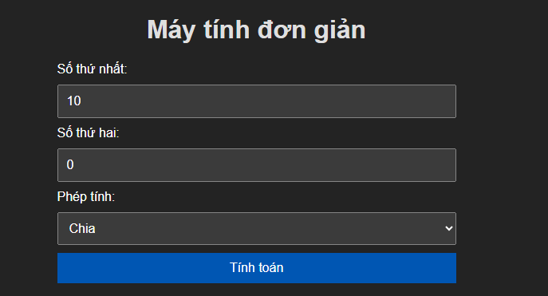

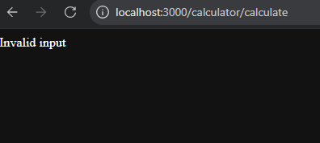

## 4. Kết quả

Đã thực hiện các ví dụ Express Framework và xây dựng ứng dụng máy tính sử dụng mô hình MVC trên máy tính cá nhân.